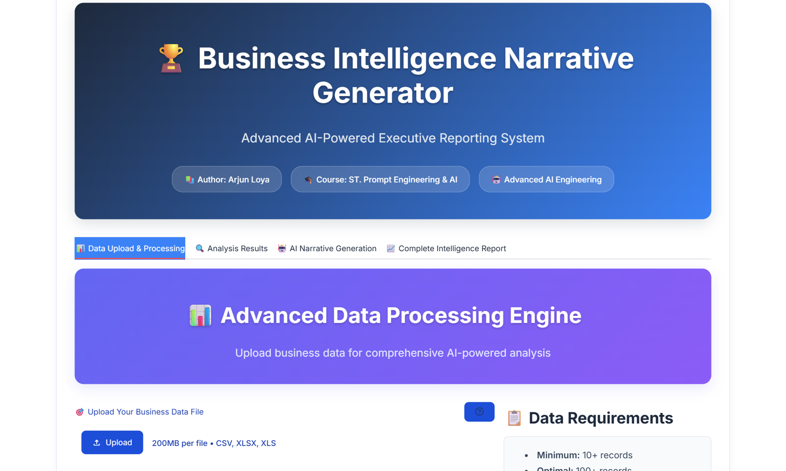

# BI Narrative Generator

**Turn a business dataset into a written executive report.** Upload a CSV or Excel file and the app analyses it, picks out trends, KPIs and correlations, then asks Google Gemini to write a narrative for the audience you choose. A prompt engine builds that request from the analysis.

Built with Streamlit, pandas, SciPy, Plotly and the Gemini API. It also runs without an API key, in demo mode.



## Contents

- [How it works](#how-it-works)
- [Quick start](#quick-start)
- [Using the app](#using-the-app)
- [Project structure](#project-structure)
- [Sample datasets](#sample-datasets)
- [Tests](#tests)
- [Limitations](#limitations)
- [About](#about)

## How it works

```
CSV / Excel ──► Data processor ──► Prompt engine ──► Gemini ──► Narrative ──► HTML / Markdown / JSON export
                 trends, KPIs,      style + audience            (or demo text
                 correlations,      + domain + charts            without a key)
                 business domain
```

| Step | What happens | Code |
|---|---|---|
| **Analyse** | Detects the business domain from column names. Computes monthly trends (when there's a date column), KPIs, correlations and a data-quality score | `src/data_processor.py` |
| **Visualise** | Monthly trend line, breakdown by category and a correlation heatmap. Each chart also gets a one-line description with real numbers | `src/app.py`, `src/visualizer.py` |
| **Prompt** | Builds a prompt from the analysis, the chosen **style** (4), **audience** (4) and **domain** (5), plus the chart descriptions so the model can refer to the charts | `src/prompt_engine.py` |
| **Generate** | Sends the prompt to Gemini (`gemini-2.5-flash` by default). Without a key, or if the call fails, it shows a pre-written demo narrative and labels it as such | `src/narrative_generator.py` |
| **Score** | A heuristic checklist rates the text on length, structure, business language, figures and actionable recommendations | `src/narrative_generator.py` |
| **Export** | HTML report, data summary (JSON) and full package (JSON) | `src/app.py` |

## Quick start

Requires **Python 3.10+**.

```bash
git clone https://github.com/Loya-ar/bi-narrative-generator.git
cd bi-narrative-generator

python -m venv .venv
# Windows:  .venv\Scripts\activate
# macOS/Linux:  source .venv/bin/activate

pip install -r requirements.txt
```

**Add a Gemini API key** (optional, free at [ai.google.dev](https://ai.google.dev/)):

```bash
cp .env.example .env
# then edit .env:  GEMINI_API_KEY=your_key
```

**Run the app:**

```bash
streamlit run src/app.py
```

It opens at http://localhost:8501. Without a key, the app runs in demo mode and says so on screen.

## Using the app

1. **Data Upload.** Upload a CSV or Excel file, or click one of the two demo datasets.
2. **Analysis Results.** Review the metrics, trends and KPIs, then click **View Visualizations**.

   
   

3. **AI Narrative Generation.** Pick a style, audience and focus, then generate.

   

4. **Complete Intelligence Report.** Read the full report and export it.

| Option | Choices |
|---|---|
| Narrative style | executive summary, detailed analysis, board presentation, strategic planning |
| Audience | executive, manager, analyst, board of directors |
| Focus | overall performance, growth trends, risk analysis, optimisation opportunities |

## Project structure

```
bi-narrative-generator/
├── src/
│   ├── app.py                  # Streamlit app (entry point)
│   ├── data_processor.py       # Analysis: domain, trends, KPIs, correlations, quality
│   ├── prompt_engine.py        # Builds the prompt from analysis + style + audience
│   ├── narrative_generator.py  # Gemini client, demo fallback, quality scoring
│   └── visualizer.py           # Plotly chart helpers
├── scripts/
│   └── generate_sample_data.py # Regenerates the sample datasets
├── data/sample_datasets/       # Example CSVs (see below)
├── tests/                      # pytest suite (no API key needed)
├── docs/
│   ├── index.html              # Project landing page
│   ├── project-report.pdf      # Course write-up
│   └── screenshots/
├── .streamlit/config.toml      # Light theme (the custom styling expects it)
├── .env.example
└── requirements.txt
```

## Sample datasets

All synthetic, in `data/sample_datasets/`. The first two are one click away in the app; the rest are handy for trying uploads.

| File | Rows | Domain |
|---|---:|---|
| `sales_performance_2023.csv` | 1,816 | Sales transactions, 12 months, 4 regions |
| `marketing_campaigns_2023.csv` | 324 | Weekly results for 12 campaigns across 7 channels |
| `marketing_performance_2023.csv` | 162 | Weekly ROI for 6 campaigns |
| `financial_kpis_2022_2023.csv` | 18 | Monthly revenue, costs and profit |
| `financial_performance_2022_2023.csv` | 24 | Monthly P&L, including R&D |
| `sales_data.csv` | 90 | Small daily sales file |
| `marketing_data.csv` | 50 | Small campaign file |
| `sales_sample.csv` | 20 | Tiny sales file for quick tests |

Regenerate the main ones with `python scripts/generate_sample_data.py`.

## Tests

```bash
pytest
```

17 tests cover the analysis output, domain detection, monthly trend calculation, that every sample dataset loads, prompt adaptation to style and audience, demo mode without a key, the quality scorer and the chart helpers. None of them calls the API.

## Limitations

- **The quality score is a heuristic.** It checks for things like headings, business vocabulary, figures and recommendation verbs. It doesn't judge accuracy.
- **Demo mode shows pre-written text** that isn't based on your data. Real, data-specific narratives need a Gemini API key.
- **Domain detection matches keywords in column names**, so unusual column names can be misclassified.
- The sample datasets are synthetic.

## About

Built by **Arjun Loya** for *ST. Prompt Engineering & AI* at Northeastern University, August 2025. The course write-up is in [`docs/project-report.pdf`](docs/project-report.pdf), and there's a demo video on [YouTube](https://www.youtube.com/watch?v=I9AnaoJjAGc).

Released under the [MIT License](LICENSE).
