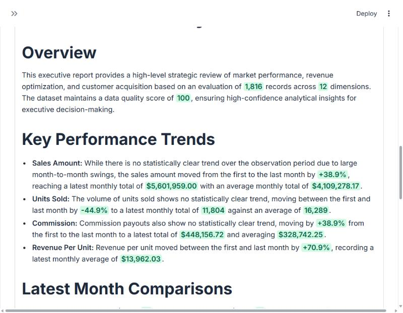
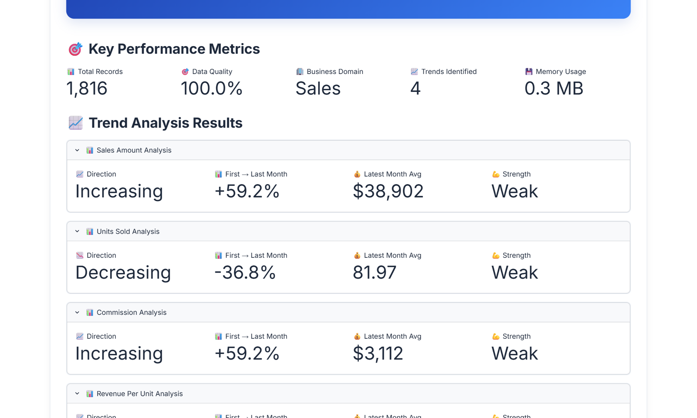
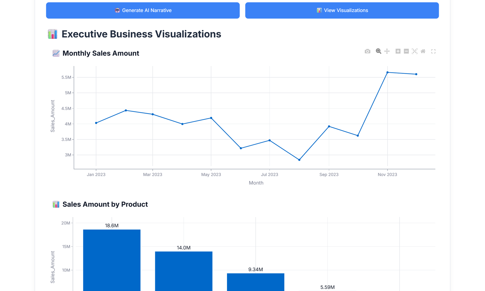
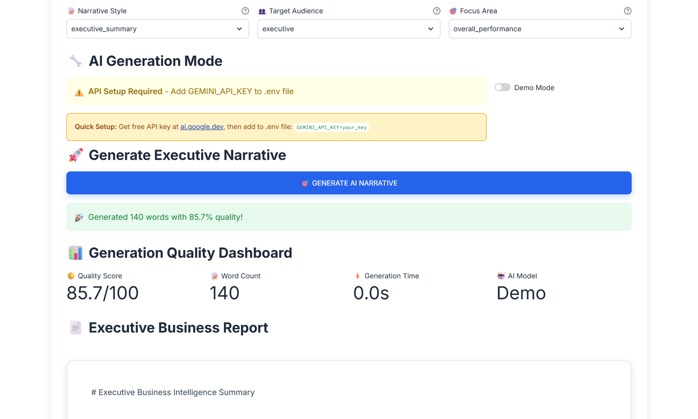
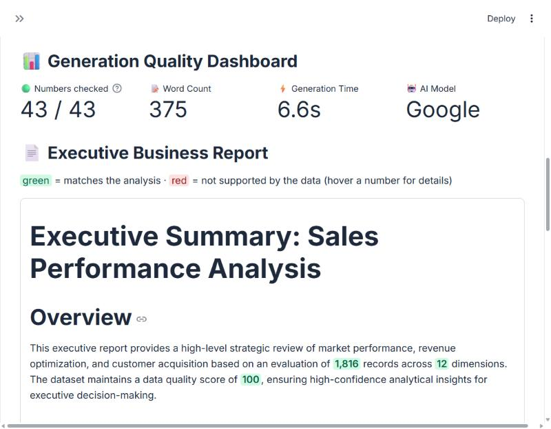

# BI Narrative Generator

[](https://github.com/Loya-ar/bi-narrative-generator/actions/workflows/tests.yml)

**Turn a business dataset into a written executive report.** Upload a CSV or Excel file and the app analyses it, picks out trends, KPIs and correlations, then asks Google Gemini to write a narrative for the audience you choose. **Every number in the report is checked against the analysis**: correct ones show green, unsupported ones red, and Gemini gets one chance to fix them. On 14 test reports, 93.3% of numbers were supported with the original prompt and 100% after the checker ([results](#evaluation)).

Built with Streamlit, pandas, SciPy, Plotly and the Gemini API. It also runs without an API key, in demo mode.



## Contents

- [How it works](#how-it-works)
- [Quick start](#quick-start)
- [Using the app](#using-the-app)
- [Project structure](#project-structure)
- [Sample datasets](#sample-datasets)
- [Evaluation](#evaluation)
- [Tests](#tests)
- [Limitations](#limitations)
- [About](#about)

## How it works

```
CSV / Excel ──► Data processor ──► Prompt engine ──► Gemini ──► Number check ──► Narrative ──► export
                 trends, KPIs,      style + audience  (JSON:    every number vs     green / red
                 correlations,      + domain + charts  report +  the analysis;       numbers
                 business domain    + fact sheet       claims)   one fix pass
```

| Step | What happens | Code |
|---|---|---|
| **Analyse** | Detects the business domain from column names. With a date column, totals each measure per month (rates and ratios are averaged), then: a trend that's called increasing or decreasing only if the regression p-value is below 0.05; the latest month vs the month before and the same month a year earlier; which segments (region, product, channel...) drove the change from the first to the last month; and unusual months (robust z-score above 3.5). Also KPIs, correlations and a data-quality score | `src/data_processor.py` |
| **Visualise** | Monthly trend line, breakdown by category and a correlation heatmap. Each chart also gets a one-line description with real numbers | `src/page_analysis.py`, `src/visualizer.py` |
| **Prompt** | Builds a prompt from the analysis, the chosen **style** (4) and **audience** (4), the **business domain** detected from the columns (sales, marketing, finance, operations or general), plus the chart descriptions so the model can refer to the charts | `src/prompt_engine.py` |
| **Generate** | Adds a fact sheet (every number the analysis computed, with an id) and asks Gemini (`gemini-3.5-flash-lite` by default, free tier) for JSON: the report plus, for each number, the fact it came from. Without a key, or if the call fails, it shows a pre-written demo narrative and labels it as such | `src/narrative_generator.py` |
| **Check numbers** | Finds every number in the report text, not just the declared ones, and compares it with the fact sheet, allowing for rounding, percent and K/M/B formats. If any number is wrong or unsupported, Gemini gets one correction pass with the real values. The app shows each number green (matches the analysis) or red (not supported), and a score such as "23 / 24 numbers checked" | `src/fact_check.py` |
| **Export** | HTML report, data summary (JSON) and full package (JSON) | `src/app.py` |

## Quick start

Requires **Python 3.10+**.

```bash
git clone https://github.com/Loya-ar/bi-narrative-generator.git
cd bi-narrative-generator

python -m venv .venv
# Windows:  .venv\Scripts\activate
# macOS/Linux:  source .venv/bin/activate

pip install -r requirements.txt
```

**Add a Gemini API key** (optional, free at [aistudio.google.com/apikey](https://aistudio.google.com/apikey); use a Google project with no billing linked, so it can never charge):

```bash
cp .env.example .env
# then edit .env:  GEMINI_API_KEY=your_key
```

**Run the app:**

```bash
streamlit run src/app.py
```

It opens at http://localhost:8501. Without a key, the app runs in demo mode and says so on screen.

## Using the app

1. **Data Upload.** Upload a CSV or Excel file, or click one of the two demo datasets.

   

2. **Analysis Results.** Review the metrics, trends and KPIs, then click **View Visualizations**.

   
   

3. **AI Narrative Generation.** Pick a style, audience and focus, then generate.

   

   The report shows how many of its numbers match the analysis, and marks each one green (supported) or red (not supported):

   

4. **Complete Intelligence Report.** Read the full report and export it.

| Option | Choices |
|---|---|
| Narrative style | executive summary, detailed analysis, board presentation, strategic planning |
| Audience | executive, manager, analyst, board of directors |
| Focus | overall performance, growth trends, risk analysis, optimisation opportunities |

## Project structure

```
bi-narrative-generator/
├── src/
│   ├── app.py                  # Streamlit entry point: setup, sidebar, tabs
│   ├── page_upload.py          # Tab 1: upload or pick a dataset, run the analysis
│   ├── page_analysis.py        # Tab 2: metrics, trends, comparisons, drivers, charts
│   ├── page_narrative.py       # Tab 3: generate the report, show checked numbers
│   ├── page_report.py          # Tab 4: full report and exports
│   ├── ui_common.py            # Helpers shared by the pages
│   ├── styles.css              # App styling
│   ├── data_processor.py       # Analysis: domain, trends, KPIs, correlations, quality
│   ├── prompt_engine.py        # Builds the prompt from analysis + style + audience
│   ├── narrative_generator.py  # Gemini client (JSON output, one fix pass), demo fallback
│   ├── fact_check.py           # Fact sheet, number checker, green/red highlighting
│   └── visualizer.py           # Plotly chart helpers
├── scripts/
│   ├── generate_sample_data.py # Regenerates the sample datasets
│   └── run_eval.py             # Live evaluation (needs a free Gemini key)
├── evaluation/                 # Results table and 14 example reports
├── data/sample_datasets/       # Example CSVs (see below)
├── tests/                      # pytest suite (no API key needed), run by GitHub Actions
├── .github/workflows/tests.yml
├── docs/
│   ├── index.html              # Project landing page
│   ├── project-report.pdf      # Course write-up
│   └── screenshots/
├── .streamlit/config.toml      # Light theme (the custom styling expects it)
├── .env.example
└── requirements.txt
```

## Sample datasets

All synthetic, in `data/sample_datasets/`. The first two are one click away in the app; the rest are handy for trying uploads.

| File | Rows | Domain |
|---|---:|---|
| `sales_performance_2023.csv` | 1,816 | Sales transactions, 12 months, 4 regions |
| `marketing_campaigns_2023.csv` | 324 | Weekly results for 12 campaigns across 7 channels |
| `marketing_performance_2023.csv` | 162 | Weekly ROI for 6 campaigns |
| `financial_kpis_2022_2023.csv` | 18 | Monthly revenue, costs and profit |
| `financial_performance_2022_2023.csv` | 24 | Monthly P&L, including R&D |
| `sales_data.csv` | 90 | Small daily sales file |
| `marketing_data.csv` | 50 | Small campaign file |
| `sales_sample.csv` | 20 | Tiny sales file for quick tests |

Regenerate the main ones with `python scripts/generate_sample_data.py`.

## Evaluation

`scripts/run_eval.py` generated reports for 7 of the 8 sample datasets (`sales_sample.csv` is left out because it's a 20-row slice of `sales_performance_2023.csv`) in 2 styles (executive summary for executives, detailed analysis for analysts) with `gemini-3.5-flash-lite` on a free-tier key, and checked every number. Full table: [evaluation/summary.md](evaluation/summary.md); the reports themselves: [evaluation/examples/](evaluation/examples/).

| Version | Numbers supported by the analysis | Share |
|---|---|---|
| Original app: plain prompt, no fact sheet | 444 / 476 | 93.3% |
| With fact sheet and JSON claims, first draft | 550 / 578 | 95.2% |
| After the correction pass (what the app shows) | 544 / 544 | **100%** |

The correction pass ran in 6 of 14 reports. Read the results with these caveats:
- **The fix mostly removes numbers.** Final reports have 34 fewer numbers than first drafts: Gemini was told to drop numbers it can't support, and it mostly did that rather than correct them.
- **"Supported" means the number exists in the analysis**, not that the sentence uses it correctly (see Limitations).
- **The fact sheet alone isn't always better.** On the two finance datasets the first drafts were weaker than the original prompt (101 of 119 supported, 85%, versus 136 of 149, 91%). The correction pass is what makes every report clean.
- **14 reports on synthetic data** is a small sample, and results vary between runs.

## Tests

```bash
pytest
```

59 tests cover the analysis output, the period analysis (significance, month-over-month and year-over-year, segment drivers, unusual months) on synthetic data with known answers, domain detection, monthly trend calculation, that every sample dataset loads, prompt adaptation to style and audience, demo mode without a key, the chart helpers, the whole app run headless (demo dataset to checked report), and the number checker: parsing formats like `$1.2M` and `12.3%`, rounding, wrong versus unsupported numbers, highlighting, and the correction pass (with a fake Gemini). None of them calls the API.

## Limitations

- **Changes compare single months** (first vs last month, latest vs previous), which can be noisy, and a partial first or last month makes totals look smaller. The p-value test guards the trend label, not these comparisons.
- **Driver shares can exceed 100%** when other segments fell, and the breakdown is skipped for changes under 5%.
- **The number check confirms a number exists in the analysis, not that the sentence uses it correctly.** "Revenue fell 12%" passes if 12% is a real change, even if the sentence mixes up which measure fell. Signs are ignored, and a rounded number (e.g. 12%) can match any fact that rounds to it.
- **Demo mode shows pre-written text** that isn't based on your data. Real, data-specific narratives need a Gemini API key.
- **Domain detection matches keywords in column names**, so unusual column names can be misclassified.
- The sample datasets are synthetic.

## About

Built by **Arjun Loya** for *Prompt Engineering & AI* at Northeastern University, August 2025. The course write-up is in [`docs/project-report.pdf`](docs/project-report.pdf), and there's a demo video on [YouTube](https://www.youtube.com/watch?v=I9AnaoJjAGc).

Released under the [MIT License](LICENSE).
